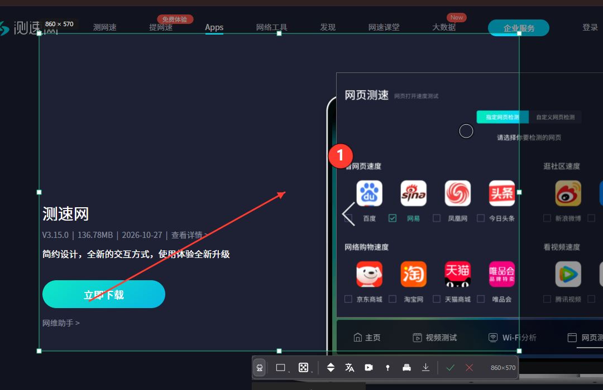

# 青蛙截图OCR

> 截图 · 标注 · OCR 识别 · 翻译 · 长截图 · 录屏 —— 一个 400 KB 的单文件 Windows 工具，全程离线可用。

<p align="left">
  
</p>

---

## 功能

| 分类 | 能力 |
|---|---|
| 截图 | 全屏变暗框选、8 向拉伸、选区拖动、放大镜取色、上一次选区记忆 |
| 标注 | 矩形 / 椭圆 / 直线 / 箭头 / 画笔 / 文字 / 序号自动递增 / 说明气泡 |
| 隐私 | 马赛克（8·16·24·32 px 像素块），拖动涂抹，笔刷粗细可调 |
| 长截图 | 框选区域后手动滚轮，逐格拼接，绿色边框标出抓取范围，右下角实时预览；面板「竖/横」一键切换，宽表格可横向拼接 |
| 识别 | **内置离线 OCR**（Windows 自带引擎 + 灰度增强双通道，不装天若也能用）；有微信组件时可切换；F4 一键识别并复制 |
| 表格 | 识别后点「表」，按行列坐标重新聚类成表格，输出 TSV / CSV，直接粘进 Excel 自动分列 |
| 翻译 | 识别后自动翻译，支持中/英/日/韩，结果在原文位置覆盖显示 |
| 录屏 | 区域录制 30/60 fps，鼠标高亮，麦克风 + 系统声音，输出 H.264 MP4 |
| 贴图 | 钉在桌面：拖动、滚轮缩放、Ctrl+滚轮透明度 |
| 其它 | 打印、另存为 PNG/JPG、开机启动、系统托盘常驻、无广告无联网上报 |

## 快捷键

| 按键 | 功能 |
|---|---|
| `PrintScreen` | 截图（可在设置里改） |
| `F4` | 截图 + 识别 + 自动复制到剪贴板 |
| `Enter` | 完成并复制 |
| `Esc` | 退出本次截图 |
| `Ctrl+Z` | 撤销标注 |
| `Ctrl+S` | 另存为 |
| `Ctrl+P` | 钉在桌面 |
| `Ctrl+D` / `Ctrl+T` | 识别 / 识别并翻译 |
| `Ctrl+L` / `Ctrl+R` | 长截图 / 录屏 |
| `R O L A P T N B M` | 切换 矩形/椭圆/直线/箭头/画笔/文字/序号/气泡/马赛克 |

## 系统要求

- Windows 10 1903+ / Windows 11（自带 .NET Framework 4.8，无需另装）
- 文字识别需要系统中安装「中文(简体) 光学字符识别」语言组件
  设置 → 时间和语言 → 语言 → 中文(简体) → 语言选项 → 光学字符识别

## 下载与安装

到 [Releases](../../releases) 下载：

- `青蛙截图OCR-Setup.exe` — 安装版（约 550 KB），自动创建桌面与开始菜单快捷方式，可在「应用和功能」里卸载
- `青蛙截图OCR.exe` — 绿色版单文件，双击即用，不写注册表

静默安装：`青蛙截图OCR-Setup.exe /S`
静默卸载：`"%LOCALAPPDATA%\Programs\QingwaSnapOCR\unins.exe" /U /S`

## 校验真伪

每个发布版本都附带 `SHA256SUMS.txt` 与公钥证书 `QingwaSnap.cer`。

```powershell
# 1) 校验哈希
Get-FileHash .\青蛙截图OCR.exe -Algorithm SHA256

# 2) 校验数字签名主体是否为作者本人
Get-AuthenticodeSignature .\青蛙截图OCR.exe | Select-Object Status, @{n='Signer';e={$_.SignerCertificate.Subject}}
# 期望输出 Signer = CN=Qingwa SnapOCR, O=Qingwa, L=Fuyang, S=Anhui, C=CN
```

签名状态显示 `UnknownError` 属于正常现象（自签名证书不在系统信任链内），
关键是**签名主体必须是上面的 CN**；被篡改过的文件会显示 `HashMismatch` 或 `NotSigned`。

## 常见问题

**长截图拼不上？**
一次只滚一格滚轮（约 100 px）。一次滚太多、页面有轮播/自动播放视频/滚动懒加载时，
重叠区域会算不准，此时该段会被跳过并提示「本次没认出重叠」，但不会拼错。

**按 PrintScreen 没反应？**
Windows 11 默认把 PrintScreen 交给系统截图工具。本程序使用低级键盘钩子抢键，
若仍冲突，请在 设置 → 辅助功能 → 键盘 里关闭「使用 Print Screen 打开截图工具」，
或把快捷键改为 `Ctrl+Shift+A`。

**OCR 识别不出来？**
检查系统是否安装了 OCR 语言组件（见上），然后把识别引擎切到「系统OCR」再试。

## 版本

当前版本 **v1.1.1**（构建 2026-11-13）。

版本号在三个地方可以看到：托盘右键菜单「关于 v1.0.1」、关于窗口标题下方、以及截图工具栏左侧「青蛙」图标的气泡提示。

截图工具栏左侧的青蛙图标、托盘菜单的「打赏支持」，都会打开打赏窗口，里面并排显示微信和支付宝的收款码。

收款码**默认已内嵌在 exe 里**，装了就能看到；同时支持从程序目录读取同名图片覆盖，换码不用重新编译：

```
把收款码截图保存为下面任一文件名，放到「青蛙截图OCR.exe」旁边：

donate-微信.png        微信收款码或赞赏码
donate-支付宝.png      支付宝收款码或赞赏码
donate.png             只有一个码时用这个名字

两个都放 → 并排显示；只放一个 → 居中放大显示。
```

## 许可证

闭源专有软件，免费使用。禁止修改、反编译、二次打包与商业再分发。
完整条款见 [LICENSE.txt](LICENSE.txt)。

---

作者：Qingwa　·　反馈：GitHub Issues
